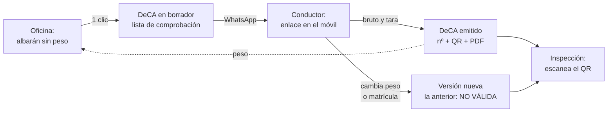
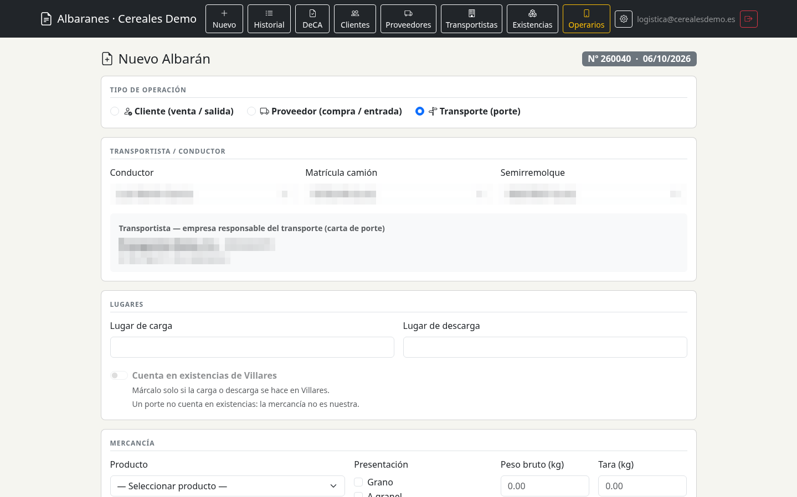
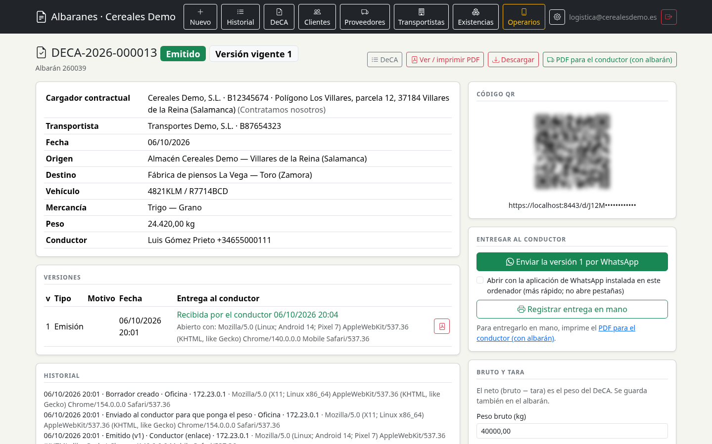
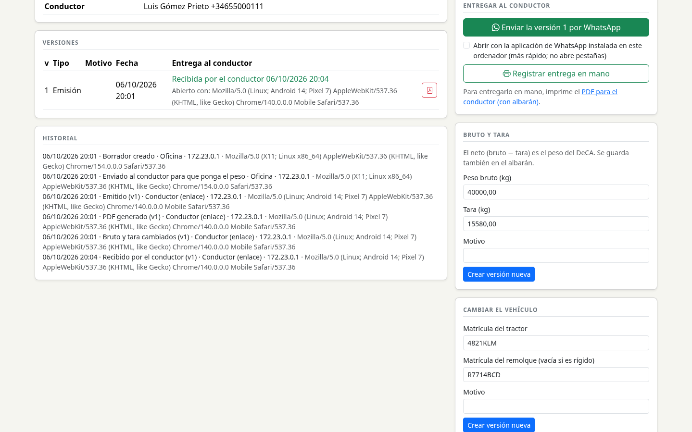
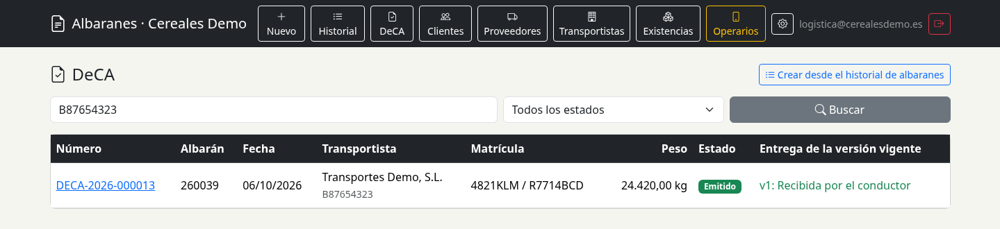
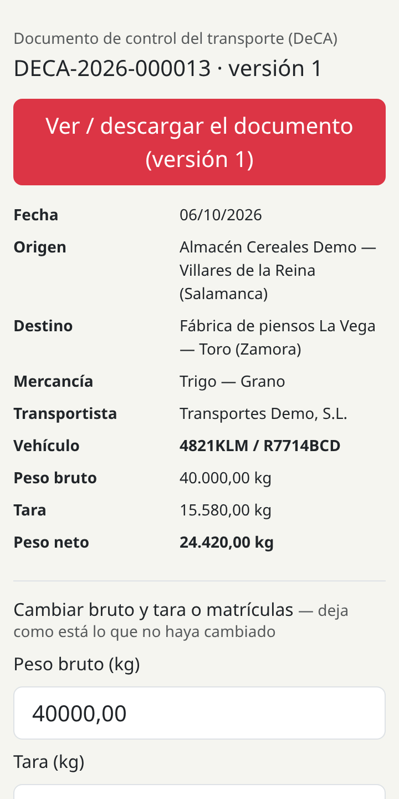
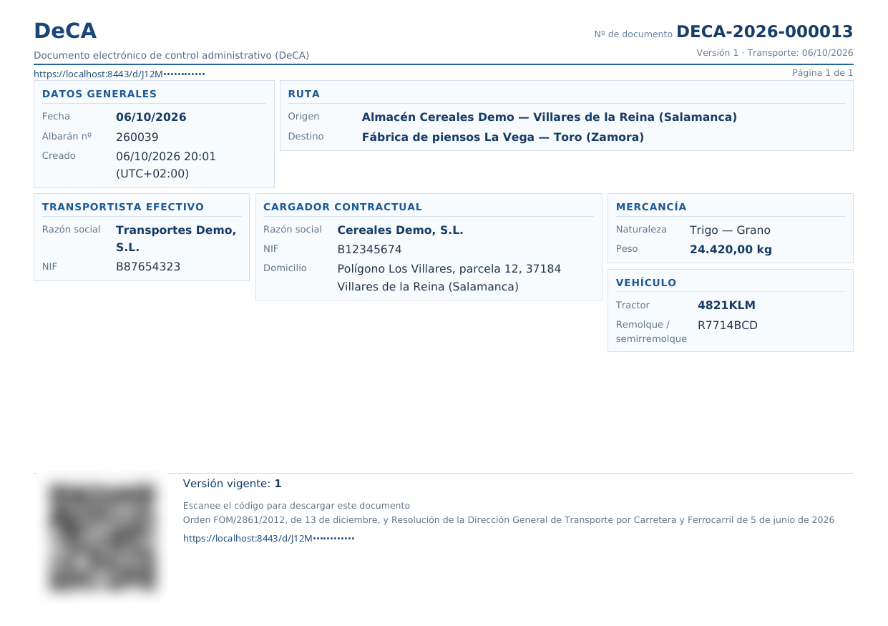
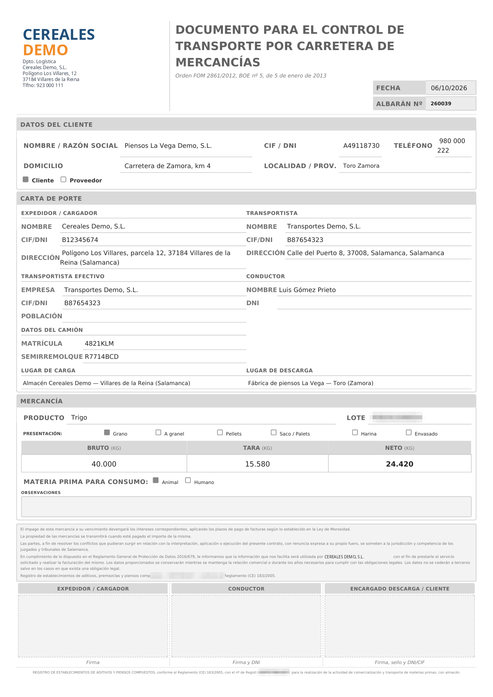

# Albaranes y DeCA digital para el transporte de cereales

Aplicación web para una empresa de transporte y comercialización de cereales. Gestiona los albaranes de entrada, salida y porte y, desde octubre de 2026, el **Documento electrónico de Control Administrativo (DeCA)** que la normativa de transporte exige llevar en formato digital.

El módulo DeCA se diseñó, desarrolló, verificó y puso en producción en **una semana**, antes de la fecha legal del **5 de octubre de 2026**. Lo construí con un proceso de ingeniería asistida por IA: varios agentes trabajaron bajo especificaciones escritas, puertas de calidad automáticas y revisión humana.

> Proyecto de cliente en producción. El código es privado porque contiene datos reales del negocio. Este documento describe la funcionalidad, la arquitectura y el proceso de desarrollo; no incluye código. La parte de albaranes está descrita en [gestion-albaranes](https://github.com/danimatper/gestion-albaranes).

---

## El problema

Todo transporte de mercancías por carretera tiene que ir acompañado de un documento de control:
- quién contrata el transporte;
- quién lo hace;
- origen y destino;
- mercancía y peso;
- vehículo.

La **Ley 9/2025 de Movilidad Sostenible** (disposición transitoria 8ª) obliga a que ese documento sea **digital desde el 5/10/2026**.

El formato y el contenido los fijan la **Orden FOM/2861/2012** (art. 6 y 7) y la **Resolución de la DGTCF de 5 de junio de 2026**. El documento ha de poder mostrarse a la inspección en el momento, desde el móvil del conductor.

En el día a día de un almacén de cereal esto choca con tres realidades:

- **El peso no se sabe cuando se prepara el viaje.** El camión se pesa en báscula al cargar, muchas veces en otro sitio y sin nadie de la oficina delante.
- **Los conductores son propios y externos.** Muchos no tienen usuario en ningún sistema; lo único que todos tienen es WhatsApp.
- **El documento cambia.** Una matrícula equivocada o una segunda pesada obligan a corregirlo, y la versión anterior tiene que quedar invalidada y trazable.

## La solución

Un módulo DeCA integrado en la aplicación de albaranes que ya usaba la oficina. El DeCA nace del albarán, sin volver a escribir nada, y el conductor completa el peso desde su móvil con un enlace.

## Funcionalidades principales

- **DeCA desde el albarán en un clic.** Cargador, transportista, origen, destino, mercancía, vehículo y conductor se rellenan solos.
  - Una *lista de comprobación* indica qué falta para cumplir el art. 6 antes de emitir.
- **Envío por WhatsApp con un único enlace por conductor.**
  - El móvil del conductor sale solo de su ficha.
  - Desde el enlace el conductor pone bruto y tara, descarga su documento y corrige peso o matrículas indicando el motivo.
  - No necesita usuario ni contraseña.
- **Emisión con número correlativo, QR y PDF legal.**
  - El QR abre siempre la **versión vigente** del DeCA, la que tiene que ver la inspección.
- **Versiones inmutables.**
  - Cada cambio crea una versión nueva.
  - Las anteriores quedan marcadas como **NO VÁLIDO**, con motivo, autor, fecha, IP y dispositivo.
- **Copia del conductor:** el DeCA y el albarán del historial en un solo PDF.
  - Si el peso cambia, el albarán se actualiza también.
- **Control de entrega.** La oficina ve, para cada versión, si el conductor la ha recibido y abierto, y con qué dispositivo.
  - Avisos de los DeCA que nadie ha enviado todavía; se pueden cerrar y se olvidan solos a las 48 h.
- **Portes (transporte para terceros).** El cargador contractual es otra empresa; el DeCA sale sin datos comerciales del cliente.
- **Anulación y archivo** con conservación del documento legal.
- **Portal del transportista** y acceso de operarios con permisos limitados.
- **Protección frente a ediciones simultáneas.** Si dos personas editan el mismo albarán, la segunda no pisa los cambios de la primera.

## Arquitectura y decisiones técnicas

- **Módulo aislado** (`app/Deca`, unas 12.000 líneas en 135 clases) organizado en capas:
  - acciones, validación, versiones, numeración, PDF, QR, enlaces, archivo y autorización, entre otras.
  - El código existente de albaranes solo se toca a través de puntos de integración concretos.
- **Instantáneas inmutables.** Cada versión guarda una foto completa de los datos, así que el documento emitido no cambia aunque luego cambie la ficha del cliente.
- **PDF legal de una sola escritura.** Se guarda una vez con su huella SHA-256; si no coincide al leerlo, se pone en cuarentena en lugar de servirlo.
- **Enlaces públicos seguros.**
  - Tokens aleatorios guardados solo como hash.
  - Búsqueda en binario: sin colaciones que acepten variantes.
  - Límites de uso por recurso y no por texto recibido.
  - Caducidad y revocación.
- **Concurrencia.** Orden de bloqueo fijo (DeCA → albarán), operaciones «comprobar y escribir» dentro de transacciones con bloqueo, y restricciones `CHECK` en MariaDB como última barrera.
- **Numeración sin huecos ni duplicados**, con contador bloqueado dentro de la misma transacción que la emisión.
- **PDF** con DomPDF; el DeCA y el albarán se unen con FPDI, con metadatos del documento y límite de tamaño.
- **Validación del contenido real de lo que se sube.** Una firma que dice ser PNG se comprueba byte a byte: un SVG camuflado podía leer ficheros del servidor a través del motor de PDF.

## El proceso: desarrollo gobernado con agentes de IA

El módulo lo desarrollaron agentes de IA, pero no a base de «pídeselo al chat y copia el resultado». Funcionó como un equipo con papeles, reglas escritas y controles que no dependen de la buena voluntad del modelo. **666 de los 733 commits** del repositorio llevan coautoría de Claude.

### Reparto de papeles

| Quién | Papel |
|---|---|
| **Yo** | Producto y decisiones: qué se hace, cómo se interpreta la normativa y qué riesgos se aceptan. Apruebo cualquier test que se debilite o se borre, pruebo con la oficina real y despliego. Ningún agente toca `main` ni producción. |
| **Claude Code (coordinador, local)** | Convierte el plan en tareas pequeñas con especificación escrita, integra las ramas, ejecuta las validaciones y me trae las decisiones. |
| **Sesiones de Claude Code en la nube (trabajadoras)** | Implementan cada tarea en su propia rama. Reciben la tarea como fichero y responden en una rama de estado que vigila el coordinador. |
| **Codex (OpenAI)** | Revisor adversario independiente y de solo lectura: lee el código contra la especificación buscando fallos. Trabaja con cola y control de cuota. |
| **Antigravity (Gemini)** | Tareas delegadas puntuales. |

Usar modelos de proveedores distintos para implementar y para revisar es deliberado: un mismo modelo tiende a pasar por alto sus propios fallos. Codex encontró, por ejemplo, una carrera entre la versión vigente del DeCA y el albarán al generar la copia del conductor.

### 1. Primero la especificación, después el código

- **Plan maestro** con 9 fases, arquitectura objetivo, máquina de estados y estándares.
- **Marco legal verificado** contra el BOE antes de escribir una línea, con las fuentes citadas.
- **Registro de decisiones cerradas** que manda sobre cualquier otro documento.
- **29 especificaciones de tarea.** Cada una con:
  - objetivo;
  - criterios de aceptación;
  - ficheros permitidos y prohibidos;
  - nivel de riesgo.
- Todo lo que toca `app/Deca`, tokens, PDF/QR, numeración o migraciones es **risk:high** y lleva revisión humana obligatoria.

### 2. «Un test en verde no dice nada»

Cada tarea pasa un protocolo de verificación de 10 pasos, con la salida real de los comandos como evidencia:

1. Tabla criterio de aceptación → test → assert que lo demuestra.
2. **Rojo primero:** el test nuevo falla antes del cambio, por el motivo esperado.
3. **Revertir y fallar:** con el cambio revertido, el test vuelve a fallar.
4. **Mutación** (Infection) sobre las líneas cambiadas; cada mutante superviviente se mata o se justifica.
5. Auditoría de asserts: se comprueban efectos reales y la ausencia de efectos en los casos negativos.
6. **Anti-trampas:** ningún test borrado, saltado o debilitado sin mi aprobación, que queda registrada.
7. Carril MySQL si hay transacciones o SQL específico.
8. Revisión adversaria del código contra la especificación.
9. Prueba manual en la aplicación.
10. Puerta de calidad completa en verde.

### 3. Una puerta de calidad que no se negocia

- Larastan al **nivel máximo, sin baseline**, en el módulo.
- PHPUnit en orden aleatorio y modo estricto en **SQLite, MySQL y MariaDB**: **3.713 tests y 28.287 asserts**.
- Cobertura: **≥ 95 % en el módulo DeCA**, ≥ 85 % global.
- Mutación: **MSI ≥ 85 %**.
- Tests end-to-end con Laravel Dusk.
- Auditoría de dependencias.
- CI en GitHub Actions.

Si un control falla, la tarea no está terminada. No se baja el umbral, no se amplía la baseline y no se excluye el fichero.

### 4. Los errores se convierten en reglas

Cada fallo encontrado, por un revisor, por un test o en producción, se apunta en un registro de **lecciones aprendidas** (166 a día de hoy). Los agentes las leen antes de cada tarea y muchas se han convertido en comprobaciones automáticas. Algunas reales:

- Una firma «PNG» que era un SVG y que el motor de PDF procesaba → validación del contenido, no del prefijo.
- Un token que aceptaba variantes en mayúsculas por la colación de MySQL → búsqueda por hash en binario.
- 8 de cada 10 mutaciones manuales sobrevivían a la suite original → protocolo de rojo, revertir y mutación obligatorio.

### 5. Lo que no funcionó, y cómo lo corregí

El primer tramo tuvo bastante retrabajo, por tres motivos:
- ramas en paralelo que se pisaban;
- más de 100 aprobaciones humanas de cambios triviales en tests;
- colas de revisión lanzadas en paralelo que agotaron la cuota en minutos.

A mitad del proyecto fijé cuatro normas:
1. Una sola rama a la vez en las zonas compartidas.
2. Revisión adversaria a fondo solo para lo crítico (núcleo legal, seguridad, datos, despliegue).
3. Aprobación humana solo cuando un test se debilita o se borra.
4. Cerrar el alcance unos días antes de cada fecha límite.

### 6. Más allá del código

Los vídeos de formación para la oficina y los conductores también se generan automáticamente:
- Selenium graba la aplicación real;
- la locución se genera con síntesis de voz y se sincroniza con las acciones;
- el montaje se hace con ffmpeg.

Cuando cambia una pantalla, el vídeo se vuelve a grabar en lugar de editarse a mano.

## Estado

**En producción desde el 5 de octubre de 2026.** Lo usa a diario la oficina, y los conductores, propios y externos, lo reciben en el móvil.

## Stack

| Capa | Tecnología |
|---|---|
| Backend | PHP 8.4, Laravel 13 |
| Base de datos | MariaDB 10.11 (tests también en MySQL y SQLite) |
| PDF / QR | DomPDF, FPDI, generación de QR |
| Frontend | Blade, Bootstrap, JavaScript |
| Calidad | PHPUnit, Laravel Dusk, Larastan, Infection, Pint, GitHub Actions |
| Entorno | Docker y WSL en desarrollo; Plesk en producción |
| IA | Claude Code (coordinador y trabajadoras), Codex (revisión), Gemini (tareas delegadas) |

## Mi rol

Proyecto individual de principio a fin:
- análisis del problema con la oficina y los conductores;
- lectura e interpretación de la normativa;
- diseño de la solución y de la arquitectura;
- definición del proceso de desarrollo con agentes y de sus controles;
- revisión y aprobación de cada cambio;
- pruebas reales, despliegue y formación del personal.

## Capturas

> Las capturas usan datos ficticios («Cereales Demo», «Transportes Demo»); la marca y los datos reales están anonimizados. Los códigos QR y los enlaces aparecen difuminados.

**Nuevo albarán de tipo porte**

**Ficha del DeCA emitido:** datos, QR, entrega al conductor y corrección de peso

**Versiones e historial completo**, con quién hizo qué, cuándo y desde qué dispositivo

**Listado de DeCA** con el estado de entrega de la versión vigente

**El enlace del conductor en el móvil**

**El DeCA en PDF**

**El albarán que acompaña al DeCA en la copia del conductor**

